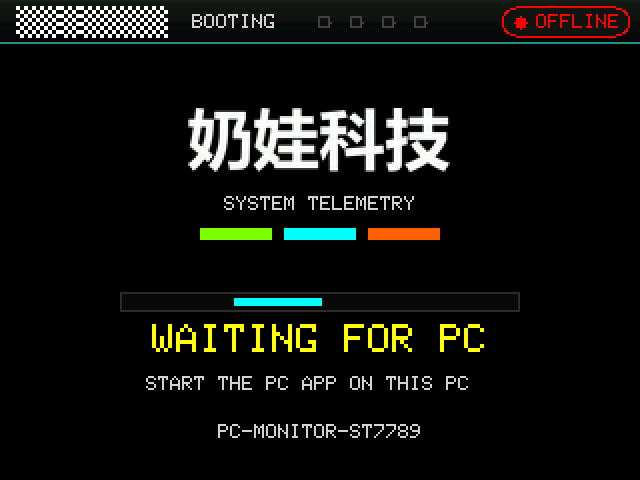
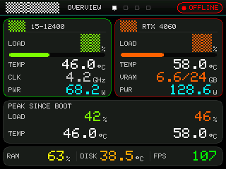
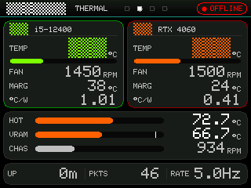
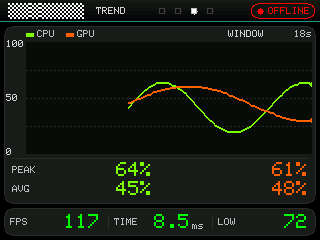
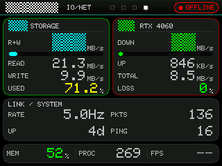

# PC Monitor —— ESP32 + ST7789 的 PC 硬件监控副屏

一块 2.8 寸小屏（ESP32-S3 + ST7789，320×240）当 PC 的硬件监控副屏：CPU/GPU 负载、
温度、功耗、风扇、显存、磁盘与网络吞吐、延迟、进程数、运行时长，以及**实测帧率**和
1% low，四页轮播。

PC 端用 Python（`psutil` + LibreHardwareMonitor + PresentMon）采集，经 **BLE** 用
二进制定标协议发给 ESP32；固件只负责显示，不做任何估算。

> **一条贯穿全项目的原则：屏幕上不会有编造的数字。** 传感器读不到就显示 `--`，
> 帧率拿不到就显示 `--`，宁可空着也不给一个看起来合理的假读数。
> 参见 [`PROTOCOL.md`](PROTOCOL.md) §4 与下方"为什么屏幕上是 --"。

---

## 界面

上电先显示开机画面（品牌字 + 扫描条 + 真实状态），**连上 PC 并收到真数据之后**
才切到数据页面 —— 这样"PC 端程序还没启动"时屏幕上不是一片 `--`：



四页轮播：

| 概览 | 散热 |
|---|---|
|  |  |

| 趋势 | IO · 网络 |
|---|---|
|  |  |

（这些图是 **UI 仿真**渲染出来的，用的是固件真实代码，不是示意图。
字体 2/4 在仿真里是等宽占位块，真机上是真实字形。）

---

## 你需要准备

**硬件**

| | |
|---|---|
| MCU | ESP32-S3 |
| 屏 | ST7789，240×320 竖屏（`setRotation(1)` 出横屏 320×240），SPI |
| 接线 | 见 [`PC_Monitor/tft_setup.h`](PC_Monitor/tft_setup.h) —— **这是全项目唯一的引脚定义处**，改接线只改这一个文件 |

**软件**

| | 版本 | 说明 |
|---|---|---|
| Arduino ESP32 core | 3.3.10 | 固件编译 |
| TFT_eSPI | 2.5.43 | 已随仓库放在 `libraries/TFT_eSPI`（整库拷贝，MIT） |
| Python | 3.13 | PC 端 |
| Python 依赖 | 见 [`requirements.txt`](requirements.txt) | `psutil` / `bleak` / `pythonnet` |
| g++（MinGW-w64） | 任意近期版本 | 只用于跑验证脚本（语法检查 + 离线 UI 仿真） |

**`dlls/` 不在仓库里**（它是 LibreHardwareMonitor 的托管 DLL 集合，第三方二进制）。
没有它，PC 端启动后**所有读数都是 `--`**。取得方式二选一：

- 从 [LibreHardwareMonitor](https://github.com/LibreHardwareMonitor/LibreHardwareMonitor)
  的 release 里取 `LibreHardwareMonitorLib.dll` 及其依赖，放进运行目录的 `dlls/`；
- 或者把已有的 `dlls/` 目录整体复制过去。

`deploy.ps1` 会检查这个目录并在缺失时明确告警（不会静默出一个"能启动但读不到数"的 exe）。

---

## 快速开始

### 1. PC 端

```powershell
python -m pip install -r requirements.txt
# 把 pc_side/proto_v2.py 和 pc_side/pc_monitor_v2.py 放在同一目录（部署时会改名成
# pc_monitor_libre.py），旁边放 dlls\ 和 PresentMon-2.6.0-x64.exe，然后运行：
python pc_monitor_v2.py
```

**建议以管理员身份运行**：AMD 平台的 Tctl 温度/功耗、NVMe 温度、以及 PresentMon 的
ETW 会话都需要管理员权限；普通权限下这些字段会显示 `--`。
不想每次提权的话，把自己的账号加进本地 `Performance Log Users` 组也能让 PresentMon 工作。

可调参数写在 exe 旁边的 `pc_monitor.ini`（模板见
[`pc_side/pc_monitor.ini.sample`](pc_side/pc_monitor.ini.sample)）：采集间隔、帧率来源、
PING 目标、自动退出时长等，改完重启即生效，不用重新打包。
键名写错、数值超范围都会在日志里点名，不会静默失效。

### 2. 固件

Arduino IDE 打开 [`PC_Monitor/PC_Monitor.ino`](PC_Monitor/PC_Monitor.ino) 直接上传
（板型 ESP32-S3，库路径指向 `libraries/`）。一上电就能看到开机画面；
PC 端连上后自动进数据页。

### 3. 验证（改完代码先跑这个）

```powershell
.\build.cmd            # 全部（含离线 UI 仿真）
.\build.cmd -Quick     # 跳过最慢的 UI 仿真
```

八步全绿才算通过：金标向量同步 → 协议跨语言比对（Python 编码 / C++ 解码）→
固件语法检查 + 引脚表自检 → PC 端逻辑测试 → **离线 UI 仿真与像素级断言**。

> 有些机器（开发这台就是）启用了代码完整性策略，会拒绝执行**被编辑过的 `.ps1`**，
> 报的还是一句很有误导性的 `The file ... is not digitally signed` —— 这与脚本内容
> 无关，是 Windows 在判断"文件来源可不可信"。遇到它就用 `build.cmd`
> （内部已带 `-ExecutionPolicy Bypass`，只对本次进程生效、不改机器上的任何设置）；
> 完整证据写在 [`build.ps1`](build.ps1) 头部。

---

## 仓库结构

```
PC_Monitor/          ESP32 固件
  PC_Monitor.ino     主循环：只做"取快照 → 画一帧"
  screen_draw.cpp    全部界面：4 个页面 + 开机画面 + 局部刷新（治频闪的核心）
  ble_service.cpp    BLE 回调、数据发布（临界区保护）、旧 CSV 协议兼容
  proto.cpp/.h       二进制定标协议解码
  tft_setup.h        屏幕硬件配置（唯一引脚定义处）
  boot_logo.h        开机画面品牌位图（由 tools/make_logo.py 生成，勿手改）
  config.h           阈值、刷新节奏、告警参数

pc_side/             PC 端采集 + BLE 发送
  pc_monitor_v2.py   主程序（部署时改名 pc_monitor_libre.py）
  proto_v2.py        协议实现（与固件一一对应）
  test_proto.py      金标向量的唯一来源（生成 + 自检）
  test_pc_side.py    无硬件自检：型号名、采集容错、往返、PresentMon CSV 解析…

tools/               开发期工具
  ui_preview/        离线 UI 仿真：把真实渲染代码跑在内存帧缓冲上做像素级断言
  make_logo.py       把品牌字渲染成 8 位 alpha 位图（内置字体没有汉字字形）
  probe_*.py         各层探针（传感器 / 网络 / 帧率），排查"屏幕上是 --"用

libraries/TFT_eSPI/  第三方库（整库拷贝，MIT）
vendor/              PresentMon（MIT，随包分发，见 vendor/README.md）

build.ps1 / build.cmd     一键构建 + 验证（8 步，检查每步退出码）
deploy.ps1 / deploy.cmd   把工作区同步到实际运行目录（哈希校验）
PROTOCOL.md               PC ⇄ ESP32 协议（字段表、缩放、无效值语义）
```

---

## 为什么屏幕上是 `--`

先跑对应探针，不要盯着屏幕猜：

| 现象 | 先看 | 常见原因 |
|---|---|---|
| 温度/风扇/功耗是 `--` | `tools/probe_sensors.py` | 需要管理员权限（AMD Tctl、NVMe、部分笔记本 EC） |
| FPS / 帧时间 / 1% low 是 `--` | `tools/probe_fps.py` | 没以管理员运行（PresentMon 起 ETW 会话被拒）；或当前没有正在渲染的 3D 程序（回到桌面就真的没有帧率） |
| PING / LOSS 是 `--` | `tools/probe_net.py` | 目标不可达（可在 ini 里改 `PING_HOST`） |
| 整页都是 `--` | `pc_monitor.log` 的"传感器自检"行 | 会点名是哪几个字段读不到；这种页在轮播时会被跳过 |

FPS 这一项**只报实测值**，拿不到就是 `--`：曾经有过一条"按 GPU 负载估算帧率"的兜底，
算出来恒定落在 36~60 且随负载平滑变化，看着非常可信但是编的 —— 已删除。
细节见 [`pc_side/README.md`](pc_side/README.md)。

---

## 第三方组件与许可

| 组件 | 许可 | 在仓库里的位置 |
|---|---|---|
| TFT_eSPI 2.5.43 | MIT | `libraries/TFT_eSPI/`（整库拷贝） |
| PresentMon 2.6.0 | MIT | `vendor/PresentMon-2.6.0-x64.exe`（随包分发，见 `vendor/README.md`） |
| LibreHardwareMonitorLib | MPL-2.0 | **不在仓库里**，需自行取得放进 `dlls/` |

本项目自身的许可**尚未选定**（作者保留所有权利）。如果要允许别人使用/修改/分发，
建议加一个 `LICENSE` 文件：MIT 或 Apache-2.0 都可以，两者与上面那两个 MIT 组件兼容。
（`libraries/TFT_eSPI/` 与 `vendor/` 里各自的许可不受本项目许可选择的影响，需原样保留。）
